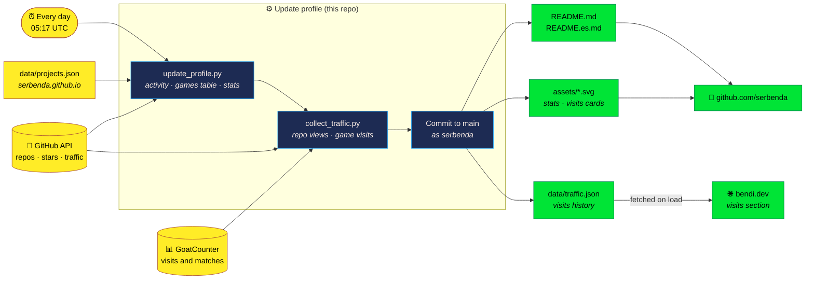
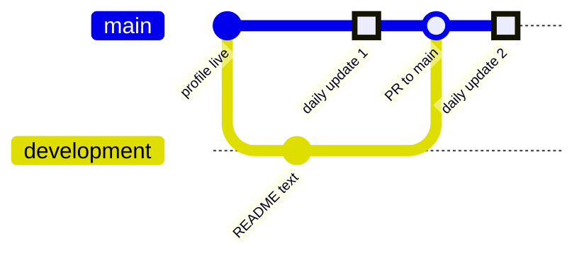

<div align="center">

# 🛠️ serbenda/serbenda · Maintenance guide

**How my GitHub profile repo works, what updates itself every morning and how to look after it.**

[](https://github.com/serbenda)
[](https://bendi.dev/)
[](https://github.com/serbenda/serbenda/actions/workflows/update-profile.yml)

</div>

> **Why this lives in `.github/` and not in the README:** a repo named after its owner is special. GitHub shows its root `README.md` on the profile page, [github.com/serbenda](https://github.com/serbenda). That README *is* the profile, so the documentation lives here instead.

---

## 📑 Contents

- [What this repo is](#-what-this-repo-is)
- [How it works](#-how-it-works)
- [Repo structure](#-repo-structure)
- [The daily workflow](#-the-daily-workflow)
- [Branches and workflow](#-branches-and-workflow)
- [Adding a new game](#-adding-a-new-game)
- [Renewing the visits token](#-renewing-the-visits-token)
- [The bendi.dev domain](#-the-bendidev-domain)
- [GoatCounter](#-goatcounter)
- [Generated images](#-generated-images)

---

## 🧭 What this repo is

| | **serbenda/serbenda** (this repo) | **[serbenda.github.io](https://github.com/serbenda/serbenda.github.io)** |
|---|---|---|
| What it is | The README of my GitHub profile | My public website |
| Where you see it | [github.com/serbenda](https://github.com/serbenda) | [bendi.dev](https://bendi.dev) |
| Format | Markdown + generated SVG cards | HTML + CSS + JS |
| Automation | A daily GitHub Action | None: it's static |
| Role in the visits system | **Collects** the visits and stores the history | **Shows** the visits |

Where everything lives:

| What | Where |
|---|---|
| The website (`bendi.dev`) | repo [serbenda.github.io](https://github.com/serbenda/serbenda.github.io) |
| What the website and this README say about each game | `data/projects.json` in the website repo, screenshots in `img/games/` |
| Each game | its own repo with its own GitHub Pages site, served at `bendi.dev/<repo-name>` |
| Daily visit collection, the README and its cards | this repo, workflow [Update profile](workflows/update-profile.yml) |
| Visit data | `data/traffic.json` in this repo; the website reads it from here |
| The domain | Porkbun (DNS) and *Settings → Pages* in the website repo |

---

## 🔧 How it works



In words:

1. **Every morning at 05:17 UTC** the *Update profile* workflow starts. It also runs when you launch it by hand, or when something in `scripts/`, `docs/` or the workflow itself is pushed to `main`.
2. **`update_profile.py`** rewrites the parts of the README between markers: the **games table** (`<!-- GAMES:START/END -->`), built from the website's `data/projects.json`, and **recent activity** (`<!-- ACTIVITY:START/END -->`). It also redraws `assets/stats.svg`.
3. **`collect_traffic.py`** collects views of every public repo from the GitHub API (which only keeps 14 days) and the visits and matches of every game from GoatCounter. It merges them into `data/traffic.json`, so the history keeps growing, and draws the visits cards `assets/traffic.svg` and `assets/traffic.es.svg`.
4. **The workflow commits the changes to `main`** as `serbenda`, and the profile shows them straight away.
5. **The website** fetches `data/traffic.json` from this repo every time someone opens it.

> ✏️ Everything outside the `GAMES` and `ACTIVITY` markers (header, badges, *About me*, footer) is written by hand and the workflow never touches it.

---

## 📁 Repo structure

```text
serbenda/
├── README.md             ← the profile in English (the one GitHub shows)
├── README.es.md          ← the profile in Spanish
├── assets/
│   ├── header.png        ← profile banner (made from header.html in the website repo)
│   ├── stats.svg         ← public stats card           (generated)
│   ├── traffic.svg       ← visits card, English         (generated)
│   └── traffic.es.svg    ← visits card, Spanish         (generated)
├── data/
│   └── traffic.json      ← full visits history          (generated)
├── scripts/
│   ├── update_profile.py ← games table, recent activity and stats
│   ├── collect_traffic.py← repo views + game visits
│   └── pixel.py          ← shared palette and helpers for the SVG cards
├── docs/
│   └── index.html        ← redirect to bendi.dev for anyone using the old address
└── .github/
    ├── MAINTENANCE.md    ← this guide
    └── workflows/
        └── update-profile.yml
```

All scripts use the **Python standard library only**: nothing to install.

---

## ⏰ The daily workflow

[`update-profile.yml`](workflows/update-profile.yml) has two jobs:

| Job | What it does |
|---|---|
| **update** | Runs both scripts and commits README, `assets/` and `data/` to `main` if anything changed |
| **pages** | Publishes `docs/` (the redirect to bendi.dev) with GitHub Pages |

| Secret / variable | What it's for | Required? |
|---|---|---|
| `GITHUB_TOKEN` | Read public repos and push the commit | Automatic |
| `TRAFFIC_TOKEN` (secret) | Read views of every repo | Optional: without it only game visits are collected |
| `GOATCOUNTER_CODE` (variable) | GoatCounter site code | Optional: defaults to the GitHub user |

**Run it by hand:** [Actions → Update profile](https://github.com/serbenda/serbenda/actions/workflows/update-profile.yml) → **Run workflow**.

---

## 🌿 Branches and workflow

| Branch | Purpose | Protection |
|---|---|---|
| **`main`** | Production: what the profile shows | No force pushes and no deletion |
| **`development`** | Hand-made changes (README text, scripts, workflow) | No force pushes and no deletion |

Hand-made changes go to `development` and reach `main` through a **pull request**:



> ⚠️ **Why `main` doesn't require a pull request here**, unlike the website repo: the daily workflow commits straight to `main`. If `main` only accepted pull requests, the workflow would fail every morning and the profile would stop updating. So `main` is protected against force pushes and deletion, and the PR flow is a habit rather than a rule.

The life of a change:

```bash
git checkout development
git pull
git merge origin/main   # bring in the daily updates first, to avoid conflicts
# … make changes …
git commit -am "Describe the change"
git push
# On GitHub: pull request from development → main, review and merge.
```

---

## 🎮 Adding a new game

1. **Repo name = address.** A repo called `my-game` will be served at `bendi.dev/my-game`. Lowercase and hyphens, no spaces or accents.
2. **Turn on GitHub Pages** in *Settings → Pages* of the game repo.
3. **Leave "Custom domain" empty** in the game repo. Empty inherits `bendi.dev`; filling it in takes the game off the domain.
4. **Relative paths** in the HTML: `img/logo.png` or `./js/game.js`, never `/img/logo.png`.
5. **Visit counter**, just before `</body>`:
   ```html
   <script>window.goatcounter = { path: '/my-game/' };</script>
   <script data-goatcounter="https://serbenda.goatcounter.com/count" async src="https://gc.zgo.at/count.js"></script>
   ```
   And wherever a match starts:
   ```js
   try { globalThis.goatcounter?.count?.({ path: "partida/my-game", title: "Partida empezada", event: true }); } catch {}
   ```
6. **Show it on the website and in the README:** add its entry to `data/projects.json` in the website repo (title, Spanish and English blurbs, tags and the screenshot at `img/games/my-game.webp`, 640×360). The README picks it up the next morning, or when you run the workflow by hand.

You never need to touch the DNS, the token or GoatCounter to add a game.

---

## 🔑 Renewing the visits token

The views of each repository are read by the [Update profile](workflows/update-profile.yml) workflow with a token stored in the `TRAFFIC_TOKEN` secret. GitHub sends an email a few days before it expires.

**To renew it:**

1. Go to [Personal access tokens](https://github.com/settings/personal-access-tokens), open **visitas-perfil** and click **Regenerate token**. Choose the expiry and copy the new token: it is only shown once.
2. In [the repo secrets](https://github.com/serbenda/serbenda/settings/secrets/actions), click the pencil next to `TRAFFIC_TOKEN`, paste the new token and save. Don't paste it anywhere else.
3. In [Actions → Update profile](https://github.com/serbenda/serbenda/actions/workflows/update-profile.yml), click **Run workflow** and check that it finishes green.

**Creating it from scratch:** a *fine-grained* token with access to **All repositories** and a single permission, **Administration: Read-only**. GitHub adds *Metadata: Read-only* on its own. Don't use a *classic* token.

**If it expires without renewal**, the website keeps working and the stored history is not lost. Only the repo views stop being collected, because GitHub keeps just the last 14 days. Game visits don't depend on the token: GoatCounter counts them.

---

## 🌐 The bendi.dev domain

- Registered with Porkbun. The DNS records are 4 `A` (185.199.108-111.153), 4 `AAAA` (2606:50c0:8000-8003::153) and a `CNAME` `www` → `serbenda.github.io`. They never need changing.
- The domain is set **only** in *Settings → Pages* of the `serbenda.github.io` repo, with *Enforce HTTPS* ticked.
- Renewed yearly at Porkbun.

---

## 📊 GoatCounter

Game visits and matches are counted by [serbenda.goatcounter.com](https://serbenda.goatcounter.com). For the website to show them, **Allow adding visitor counts on your website** must be ticked in its *Settings*. If the account code ever changes, save it as the `GOATCOUNTER_CODE` variable of this repo and change it in the website's `index.html` and in every game's too.

---

## 🎨 Generated images

`og.png` (the image shown when the website is shared) and `assets/header.png` (the banner of this profile's README) come from the `og.html` and `header.html` templates in the website repo: open them in a browser at 1200×630 and 1280×320 and take a screenshot.
