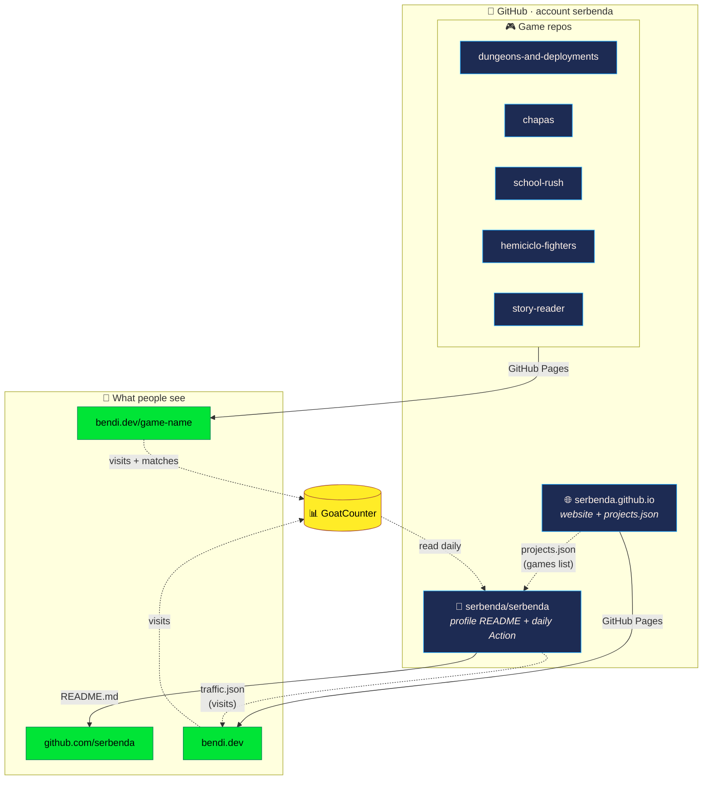
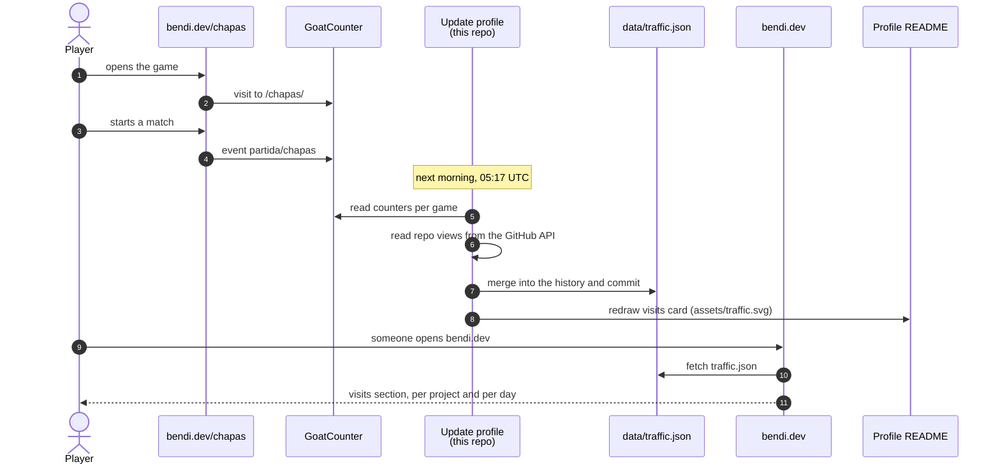
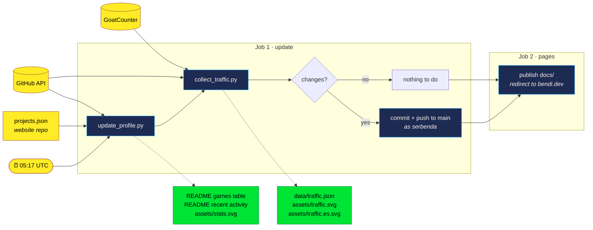
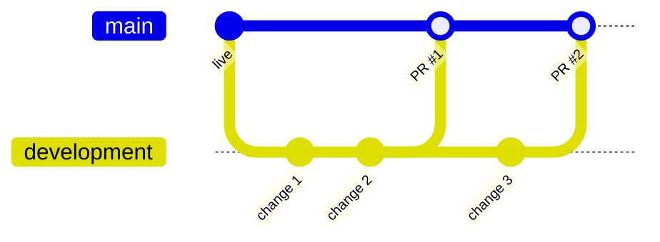
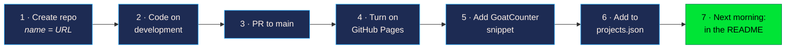

<div align="center">

# 🛠️ Bendi's GitHub · Handbook

**What each repo is for, how they fit together, what runs on its own and the process to change anything.**

[](https://github.com/serbenda)
[](https://bendi.dev/)
[](https://github.com/sponsors/serbenda)

[](https://github.com/serbenda/serbenda/actions/workflows/update-profile.yml)

</div>

> **Why this lives in `.github/` and not in the README:** a repo named after its owner is special. GitHub shows its root `README.md` on the profile page, [github.com/serbenda](https://github.com/serbenda). That README *is* the profile, so the documentation lives here instead. This repo is also where the automation runs, so it's the natural home for the whole handbook.

---

## 📑 Contents

**Understand it**
- [The big picture](#-the-big-picture)
- [Repo catalogue](#-repo-catalogue)
- [How a visit becomes a number](#-how-a-visit-becomes-a-number)
- [What happens every morning](#-what-happens-every-morning)
- [This repo, file by file](#-this-repo-file-by-file)

**Change it**
- [Branches and protection](#-branches-and-protection)
- [Process: change the website](#-process-change-the-website)
- [Process: change the profile](#-process-change-the-profile)
- [Process: publish a new game](#-process-publish-a-new-game)
- [Process: change an existing game](#-process-change-an-existing-game)

**Look after it**
- [Renewing the visits token](#-renewing-the-visits-token)
- [The bendi.dev domain](#-the-bendidev-domain)
- [GoatCounter](#-goatcounter)
- [GitHub Sponsors](#-github-sponsors)
- [Generated images](#-generated-images)
- [Troubleshooting](#-troubleshooting)

---

## 🧭 The big picture

There are three kinds of repo:

| Kind | Repo | Job in one line |
|---|---|---|
| 👤 **Profile** | `serbenda/serbenda` (this one) | The GitHub profile page **and the robot** that keeps it and the visits up to date |
| 🌐 **Website** | `serbenda/serbenda.github.io` | **bendi.dev**: the public website and the root domain for every game |
| 🎮 **Games** | one repo per game | The game itself, published at `bendi.dev/<repo>` |



The three key ideas:

1. **One list of games**: `data/projects.json` in the website repo. The website reads it directly, and the profile Action reads it every morning to rebuild the games table in the README. Add a game there and it appears in both places.
2. **One store of visits**: `data/traffic.json` in this repo. The Action writes it every morning; the website reads it every time someone opens it.
3. **One domain for everything**: `serbenda.github.io` owns **bendi.dev**. Any other repo with GitHub Pages turned on is automatically served under it as `bendi.dev/<repo>`, with no DNS changes.

---

## 📚 Repo catalogue

| Repo | What it is | Published at | Branches | Automation |
|---|---|---|---|---|
| [**serbenda**](https://github.com/serbenda/serbenda) | Profile README (EN + ES), visit history, handbook | [github.com/serbenda](https://github.com/serbenda) | `main` · `development` | **Update profile**, daily |
| [**serbenda.github.io**](https://github.com/serbenda/serbenda.github.io) | Website: about me, arcade zone, visits, contact | [bendi.dev](https://bendi.dev) | `main` · `development` | None (Pages publishes `main`) |
| [**dungeons-and-deployments**](https://github.com/serbenda/dungeons-and-deployments) | Fantasy beat 'em up, solo or co-op | [bendi.dev/dungeons-and-deployments](https://bendi.dev/dungeons-and-deployments/) | per repo | GitHub Pages |
| [**chapas**](https://github.com/serbenda/chapas) | La Vuelta de Chapas: bottle-cap cycling and football | [bendi.dev/chapas](https://bendi.dev/chapas/) | per repo | GitHub Pages |
| [**school-rush**](https://github.com/serbenda/school-rush) | Get the kids to school before the bell | [bendi.dev/school-rush](https://bendi.dev/school-rush/) | `main` · `development` | GitHub Pages |
| [**hemiciclo-fighters**](https://github.com/serbenda/hemiciclo-fighters) | 90s arcade fighting game with fictional politicians | [bendi.dev/hemiciclo-fighters](https://bendi.dev/hemiciclo-fighters/) | per repo | GitHub Pages |
| [**story-reader**](https://github.com/serbenda/story-reader) | La biblioteca mágica: reading stories, dyslexia-friendly | [bendi.dev/story-reader](https://bendi.dev/story-reader/) | `main` · `development` | GitHub Pages |
| [**deploy-quest**](https://github.com/serbenda/deploy-quest) | 8-bit Zelda-style adventure (v1 of Dungeons & Deployments) | code only, not published | per repo | — |
| [**bankinter-visa-pdf-to-csv**](https://github.com/serbenda/bankinter-visa-pdf-to-csv) | Tool: Bankinter VISA PDF statements → CSV | — | per repo | — |
| [**frameblock**](https://github.com/serbenda/frameblock) | Framework for secure Web3 apps (Master's final project) | — | per repo | — |

> The games and tools listed on the website and in the README come from `data/projects.json`, not from this table. Keep both in sync when you add or retire a project.

---

## 📊 How a visit becomes a number



Two sources, two kinds of number:

| Source | Counts | Kept by GitHub | Needs |
|---|---|---|---|
| **GoatCounter** | Visits to bendi.dev and each game, plus matches started | Forever | Nothing (public counters) |
| **GitHub traffic API** | Views of each repo on github.com | **Only 14 days** | The `TRAFFIC_TOKEN` secret |

Because GitHub forgets repo views after 14 days, `traffic.json` is the only long-term record. Don't delete or rewrite it by hand.

---

## ⏰ What happens every morning

The [Update profile](workflows/update-profile.yml) workflow runs at **05:17 UTC** (06:17 Madrid in winter, 07:17 in summer). It also runs when launched by hand, or when anything in `scripts/`, `docs/` or the workflow itself is pushed to `main`.



| Step | Script | Reads | Writes |
|---|---|---|---|
| Games table | `update_profile.py` | `projects.json` from the website repo | README between `<!-- GAMES:START/END -->` |
| Recent activity | `update_profile.py` | Latest pushed public repos | README between `<!-- ACTIVITY:START/END -->` |
| Stats card | `update_profile.py` | Repos, stars, languages | `assets/stats.svg` |
| Visits | `collect_traffic.py` | GitHub traffic API + GoatCounter | `data/traffic.json`, `assets/traffic*.svg` |

| Secret / variable | What it's for | Required? |
|---|---|---|
| `GITHUB_TOKEN` | Read public repos and push the commit | Automatic |
| `TRAFFIC_TOKEN` (secret) | Read views of every repo | Optional: without it only GoatCounter visits are collected |
| `GOATCOUNTER_CODE` (variable) | GoatCounter site code | Optional: defaults to the GitHub user |

> ✏️ Everything in the README **outside** the `GAMES` and `ACTIVITY` markers (header, badges, *About me*, footer) is written by hand. The workflow never touches it.

---

## 📁 This repo, file by file

```text
serbenda/
├── README.md             ← the profile in English (the one GitHub shows)
├── README.es.md          ← the profile in Spanish
├── assets/
│   ├── header.png        ← profile banner (from header.html in the website repo)
│   ├── stats.svg         ← public stats card            (generated)
│   ├── traffic.svg       ← visits card, English          (generated)
│   └── traffic.es.svg    ← visits card, Spanish          (generated)
├── data/
│   └── traffic.json      ← full visits history           (generated, never edit by hand)
├── scripts/
│   ├── update_profile.py ← games table, recent activity and stats
│   ├── collect_traffic.py← repo views + game visits
│   └── pixel.py          ← shared palette and helpers for the SVG cards
├── docs/
│   └── index.html        ← redirect to bendi.dev for the old serbenda.github.io/serbenda address
└── .github/
    ├── FUNDING.yml       ← shows the ❤ Sponsor button on the repo
    ├── MAINTENANCE.md    ← this handbook
    └── workflows/
        └── update-profile.yml
```

All scripts use the **Python standard library only**: nothing to install.

---

## 🌿 Branches and protection

Every repo follows the same model: **`development` for work, `main` for production, pull requests in between**.

| Repo | Branch | Require pull request | Force push / delete | Why |
|---|---|---|---|---|
| serbenda.github.io | `main` | ✅ **Yes**, no bypass | 🚫 Blocked | Production website, nothing writes to it automatically |
| serbenda.github.io | `development` | ❌ No | 🚫 Blocked | Day-to-day work |
| **serbenda** | `main` | ❌ **No** | 🚫 Blocked | ⚠️ The daily Action pushes straight to `main`. Requiring PRs would break it |
| serbenda | `development` | ❌ No | 🚫 Blocked | Day-to-day work |
| Each game | `main` | ✅ Recommended | 🚫 Blocked | Production game |
| Each game | `development` | ❌ No | 🚫 Blocked | Day-to-day work |

**How to set it up**, in each repo: *Settings → Branches → Add classic branch protection rule*, type the branch name, and:
- For a `main` that requires PRs: tick **Require a pull request before merging** (untick *Require approvals*, as there's a single maintainer) and **Do not allow bypassing the above settings**.
- For every other rule: tick nothing. A rule with nothing ticked already blocks force pushes and deletion.



**Commit author**: every commit is signed as `serbenda <serbenda@gmail.com>`, including the ones made by the daily Action.

---

## 🌐 Process: change the website

Repo: **serbenda.github.io**.

1. `git checkout development && git pull`
2. Make the change. Usual places:
   - Text: find its `data-t` key in `index.html` and edit **both** the Spanish and English dictionaries in the `<script>`.
   - Games or tools shown: `data/projects.json` and the screenshot in `img/games/`.
3. Test locally: `python3 -m http.server 8000` and open <http://localhost:8000>.
4. `git commit` and `git push` to `development`.
5. On GitHub: **pull request `development` → `main`**, review the diff, **merge**.
6. GitHub Pages publishes bendi.dev in 1–2 minutes. If you changed `projects.json`, the profile README picks it up the next morning (or run the Action by hand).

---

## 👤 Process: change the profile

Repo: **serbenda** (this one).

1. `git checkout development && git pull && git merge origin/main`. The last step brings in the Action's daily commits first, so the PR doesn't conflict.
2. Edit `README.md` **and** `README.es.md`, keeping them equivalent. Don't edit inside the `GAMES` or `ACTIVITY` markers: the Action overwrites them.
3. Commit, push to `development`, open a **pull request `development` → `main`** and merge.
4. The profile updates instantly. If you changed `scripts/` or the workflow, the Action also runs on merge: check it ends green in *Actions*.

---

## 🎮 Process: publish a new game



1. **Repo name = address.** A repo called `my-game` is served at `bendi.dev/my-game`. Lowercase and hyphens, no spaces or accents.
2. **Branches**: work on `development`, release to `main` through a PR, and protect both as in [Branches and protection](#-branches-and-protection).
3. **Turn on GitHub Pages** in *Settings → Pages* of the game repo.
4. **Leave "Custom domain" empty** in the game repo. Empty inherits `bendi.dev`; filling it in takes the game off the domain.
5. **Relative paths** in the HTML: `img/logo.png` or `./js/game.js`, never `/img/logo.png` (that would point at bendi.dev's root, not the game's folder).
6. **Visit counter**, just before `</body>`:
   ```html
   <script>window.goatcounter = { path: '/my-game/' };</script>
   <script data-goatcounter="https://serbenda.goatcounter.com/count" async src="https://gc.zgo.at/count.js"></script>
   ```
   And wherever a match starts:
   ```js
   try { globalThis.goatcounter?.count?.({ path: "partida/my-game", title: "Partida empezada", event: true }); } catch {}
   ```
7. **Show it on the website and in the README**: follow [Process: change the website](#-process-change-the-website) to add its entry to `data/projects.json` (title, Spanish and English blurbs, tags, and the screenshot at `img/games/my-game.webp`, 640×360). The profile README picks it up the next morning.
8. Optional: add a ❤ Sponsor link to the game's end screen pointing to <https://github.com/sponsors/serbenda>.

You never need to touch the DNS, the token or GoatCounter to add a game.

---

## 🔁 Process: change an existing game

1. In the game repo: work on `development`, then **pull request → `main`** and merge.
2. Pages republishes `bendi.dev/<game>` in 1–2 minutes.
3. If the title, blurb or screenshot shown on the website changes, update `data/projects.json` and `img/games/` in the website repo too.

---

## 🔑 Renewing the visits token

The views of each repository are read with a token stored in the `TRAFFIC_TOKEN` secret of this repo. GitHub sends an email a few days before it expires.

**To renew it:**

1. Go to [Personal access tokens](https://github.com/settings/personal-access-tokens), open **visitas-perfil** and click **Regenerate token**. Choose the expiry and copy the new token: it is only shown once.
2. In [the repo secrets](https://github.com/serbenda/serbenda/settings/secrets/actions), click the pencil next to `TRAFFIC_TOKEN`, paste the new token and save. Don't paste it anywhere else.
3. In [Actions → Update profile](https://github.com/serbenda/serbenda/actions/workflows/update-profile.yml), click **Run workflow** and check that it finishes green.

**Creating it from scratch:** a *fine-grained* token with access to **All repositories** and a single permission, **Administration: Read-only**. GitHub adds *Metadata: Read-only* on its own. Don't use a *classic* token.

**If it expires without renewal**, the website keeps working and the stored history is not lost. Only the repo views stop being collected, because GitHub keeps just the last 14 days. Game visits don't depend on the token: GoatCounter counts them.

---

## 🌍 The bendi.dev domain

- Registered with Porkbun. The DNS records are 4 `A` (185.199.108-111.153), 4 `AAAA` (2606:50c0:8000-8003::153) and a `CNAME` `www` → `serbenda.github.io`. They never need changing.
- The domain is set **only** in *Settings → Pages* of the `serbenda.github.io` repo (it's the `CNAME` file there), with *Enforce HTTPS* ticked.
- Renewed yearly at Porkbun.

---

## 📈 GoatCounter

Visits and matches are counted by [serbenda.goatcounter.com](https://serbenda.goatcounter.com). For the website to show them, **Allow adding visitor counts on your website** must be ticked in its *Settings*. If the account code ever changes, save it as the `GOATCOUNTER_CODE` variable of this repo and change it in the website's `index.html` and in every game's too.

---

## 💖 GitHub Sponsors

- Profile: [github.com/sponsors/serbenda](https://github.com/sponsors/serbenda), as an individual. Payouts go through Stripe to the bank account set up there.
- The ❤ button appears on the profile automatically, and on this repo thanks to `.github/FUNDING.yml`.
- To show it on **every** repo at once, create a public repo named `.github` with a `FUNDING.yml` containing `github: serbenda`.
- Links to it: badge in both READMEs, header and contact section of bendi.dev.

---

## 🎨 Generated images

`og.png` (the image shown when the website is shared) and `assets/header.png` (the banner of this profile's README) come from the `og.html` and `header.html` templates in the website repo: open them in a browser at 1200×630 and 1280×320 and take a screenshot.

---

## 🩺 Troubleshooting

| Symptom | Likely cause | Fix |
|---|---|---|
| README games table or activity didn't change | The Action failed or hasn't run yet | Check [Actions](https://github.com/serbenda/serbenda/actions); run it by hand |
| Action fails on "Commit changes" | `main` was set to require pull requests | Untick *Require a pull request* on this repo's `main` |
| Repo views stopped growing | `TRAFFIC_TOKEN` expired | [Renew the token](#-renewing-the-visits-token) |
| Game visits are zero | Missing GoatCounter snippet, or public counters turned off | Check the snippet and the [GoatCounter](#-goatcounter) setting |
| A new game isn't at `bendi.dev/<repo>` | Pages off, or a custom domain set in the game repo | Turn on Pages; leave *Custom domain* empty |
| Game loads without images or styles | Absolute paths (`/img/...`) | Use relative paths (`img/...`) |
| Website change isn't live | It's still on `development`, or Pages is still publishing | Merge the PR to `main`; wait 1–2 minutes; hard refresh |
| PR from `development` conflicts (profile repo) | The Action committed to `main` meanwhile | `git merge origin/main` into `development` and push again |
