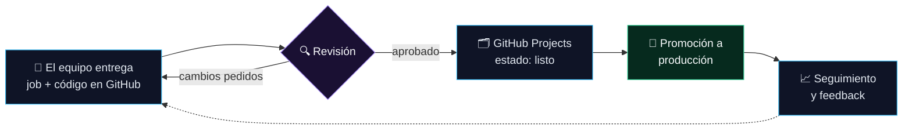
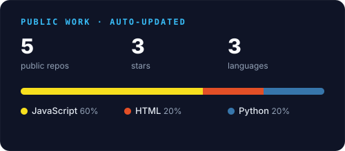
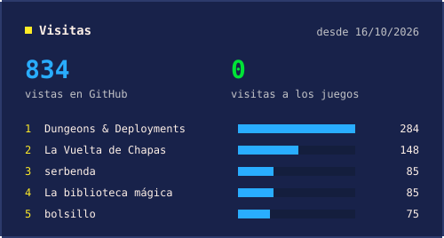

**Convierto operaciones manuales en automatización revisada y fiable, y soy el último control antes de producción.**

[🇬🇧 English](README.md) · **🇪🇸 Español**

---

## 🧭 Sobre mí

Soy **Sergio Bendaña**, *Bendi* en el trabajo, ingeniero con **más de 15 años** en automatización de infraestructura, ingeniería de sistemas y desarrollo de software.

Mi día a día está justo entre *"en mi máquina funciona"* y *"se ejecuta cada noche en producción"*:

- ⚙️ **Automatización con Rundeck**: reviso los jobs que entregan los equipos técnicos (plugins ShellScript y Python) junto con su código en GitHub.
- 🛡️ **Control de pase a producción**: nada llega a producción hasta que es correcto, seguro, idempotente y fácil de revertir.
- 🗂️ **GitHub como fuente de verdad**: cada petición se sigue en GitHub Projects desde la entrega hasta producción, y lo repetitivo lo hacen las GitHub Actions.

Antes construí infraestructura como código con Terraform y Ansible, migré entornos VMware a OpenStack, llevé plataformas Big Data con Cloudera y desarrollé aplicaciones full-stack con Node.js y React. También tengo un **Máster en Blockchain**.

---

## 🔁 Cómo llevo la automatización a producción

<b>📋 Qué reviso antes de que algo pase a producción</b>

 

| Área | Qué miro |
|---|---|
| **Corrección** | ¿Hace el job exactamente lo que pide la petición, con valores por defecto sensatos y opciones validadas? |
| **Seguridad** | Sin secretos en claro, mínimo privilegio, ningún comando destructivo sin protección. |
| **Idempotencia** | Ejecutarlo dos veces no debe romper nada. |
| **Gestión de fallos** | Timeouts, reintentos, códigos de salida claros y mensajes de error que una persona pueda entender. |
| **Marcha atrás** | Si falla a las 3 de la mañana, ¿cómo se deshace? |
| **Calidad de código** | Shell y Python legibles, `set -euo pipefail`, linting y sin divergencias por copiar y pegar entre entornos. |
| **Trazabilidad** | Enlazado a su tarjeta en GitHub Projects, versionado y revisable después. |

---

## 🛠️ Stack

    
    
  

  
  
  
  
  

---

## 🚀 Proyectos destacados

<table>
<tr>
<td width="33%" valign="top">

### 🏃 [School Rush](https://github.com/serbenda/school-rush)
Una carrera de dibujos animados para llevar a los peques al cole antes de que suene la campana de las 9:00. Hecho para jugar con mis hijas.

`HTML5 Canvas` `Vanilla JS` `0 deps` `GitHub Pages`

**[▶ Jugar](https://serbenda.github.io/school-rush/)**

</td>
<td width="33%" valign="top">

### 🛡️ [FrameBlock](https://github.com/serbenda/frameblock)
Framework para crear aplicaciones Web3 seguras y escalables. Proyecto final de mi Máster en Blockchain.

`JavaScript` `Blockchain` `Web3`

</td>
<td width="33%" valign="top">

### 🏦 [Bankinter VISA → CSV](https://github.com/serbenda/bankinter-visa-pdf-to-csv)
Extrae los movimientos de los extractos PDF de la VISA de Bankinter a CSV limpio, listo para Excel o Power BI.

`Python` `PDF` `CLI`

</td>
</tr>
</table>

---

## ⚡ Actividad reciente

<table>
<tr>
<td width="55%" valign="top">

<!-- ACTIVITY:START -->
- **[dungeons-and-deployments](https://github.com/serbenda/dungeons-and-deployments)** · `JavaScript` · ⭐ 1 · [▶ demo](https://serbenda.github.io/dungeons-and-deployments/) — Beat 'em up de fantasía en pixel art: cuatro héroes del equipo de desarrollo, solos o en cooperativo, cruzan las catacumbas del CPD, las cuevas del Mainframe y la nube. Sin dependencias, funciona en el navegador y en el móvil. (actualizado hoy)
- **[deploy-quest](https://github.com/serbenda/deploy-quest)** · `HTML` — Aventura de 8 bits con vista cenital: un dev con su teclado y su Escudo de IaC recorre las Catacumbas de Sistemas, consigue la Terminal SSH y la primera página del Grimorio de la Definition of Done. HTML5 + canvas, sin dependencias. (actualizado hoy)
- **[story-reader](https://github.com/serbenda/story-reader)** · `JavaScript` — Cuentos interactivos para leer en voz alta, pensados para la dislexia: pistas al azar, 4 niveles y reconocimiento de voz. (actualizado hoy)
- **[hemiciclo-fighters](https://github.com/serbenda/hemiciclo-fighters)** · `HTML` — Juego de lucha 2D estilo recreativa de los 90 con políticos ficticios. HTML + JS, sin dependencias. (actualizado hoy)
- **[school-rush](https://github.com/serbenda/school-rush)** · `JavaScript` · ⭐ 1 — Despierta, desayuna, asea, viste y esquiva el tráfico: ¡lleva a los peques al cole antes de la campana! 🏫⏰ (actualizado hoy)
<!-- ACTIVITY:END -->

🤖 Se actualiza cada día con una GitHub Action de este repo, porque lo automatizo todo.

</td>
<td width="45%" valign="top" align="center">

</td>
</tr>
</table>

---

## 📈 Visitas

  

Las vistas a los repos salen de la API de tráfico de GitHub y las visitas a Pages de GoatCounter. El dashboard completo, por proyecto y por día, está en <a href="https://serbenda.github.io/serbenda/#visitas">mi web</a>.

---

## 🏆 Logros

- 🛡️ Soy el **filtro de revisión y promoción de la automatización en Rundeck**, con GitHub Projects como única fuente de verdad desde la entrega hasta producción.
- ⏱️ Automaticé el aprovisionamiento de infraestructura con **Terraform Enterprise**, reduciendo mucho los tiempos de despliegue.
- ☁️ Migré **cargas de VMware a OpenStack**, mejorando el uso de recursos y reduciendo costes.
- 🔐 Diseñé **pipelines de CI/CD** seguros que hicieron más rápidos a los equipos sin saltarse controles.
- 🧰 Creé herramientas en **Python** y **Shell** que eliminaron horas de trabajo manual repetitivo.
- 📊 Puse en marcha plataformas **Big Data** con Cloudera para analítica en tiempo real.

---

**Ahora mismo:** haciendo las revisiones de automatización más rápidas y consistentes · creando juegos con mis hijas · trasteando con mi homelab

Encantado de hablar de automatización, ingeniería de plataformas y despliegues seguros. Encuéntrame en <a href="https://www.linkedin.com/in/sergio-santiago-benda%C3%B1a-quesada/">LinkedIn</a>.

