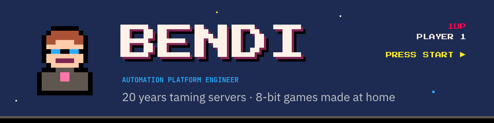
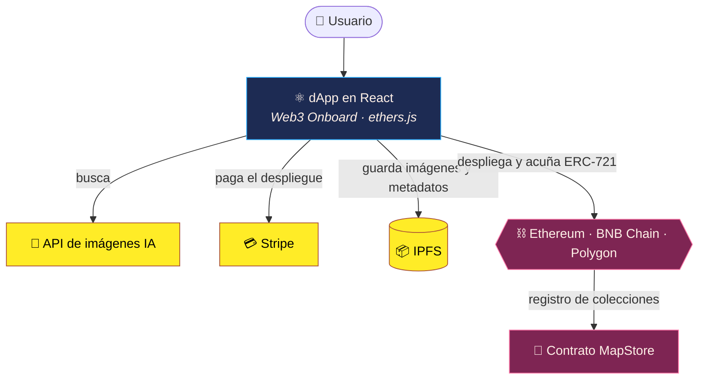

**20 años automatizando infraestructura · Máster en Blockchain · Juegos de 8 bits hechos en casa con mis hijas.**

[🇬🇧 English](README.md) · **🇪🇸 Español**

---

🤖 <b>Automatización</b> · Infraestructura como código con <b>Terraform, Ansible y Packer</b> sobre AWS, Azure, Google Cloud y nube privada 
⛓️ <b>Blockchain</b> · <b>Máster en Blockchain</b>: smart contracts en <b>Solidity</b>, NFTs, IPFS y dApps multicadena · 🏆 <a href="#blockchain">FrameBlock, mejor proyecto del máster ↓</a> 
🕹️ <b>Juegos</b> · Juegos pequeños de 8 bits en HTML + JS puro, hechos con mis hijas · <a href="https://bendi.dev/#arcade">Jugar →</a>

---

## 🕹️ Juegos

Todos se juegan en el navegador, también en el móvil. Sin instalar nada y sin anuncios.

<!-- GAMES:START -->
<table>
<tr>
<td width="50%" valign="top">

**Dungeons & Deployments** 
Beat 'em up de fantasía: un equipo de desarrollo se abre camino por las catacumbas del CPD, las cuevas del Mainframe y la nube. Solo o en cooperativo.

<a href="https://bendi.dev/dungeons-and-deployments/"><b>▶ Jugar</b></a> · <a href="https://github.com/serbenda/dungeons-and-deployments">Código</a>

</td>
<td width="50%" valign="top">

**La Vuelta de Chapas** 
El juego de chapas de toda la vida: la vuelta ciclista y el fútbol de chapas, por turnos, contra amigos o contra la máquina.

<a href="https://bendi.dev/chapas/"><b>▶ Jugar</b></a> · <a href="https://github.com/serbenda/chapas">Código</a>

</td>
</tr>
<tr>
<td width="50%" valign="top">

**School Rush** 
Despierta, desayuna, asea, viste y esquiva el tráfico: lleva a los peques al cole antes de que suene la campana de las 9:00.

<a href="https://bendi.dev/school-rush/"><b>▶ Jugar</b></a> · <a href="https://github.com/serbenda/school-rush">Código</a>

</td>
<td width="50%" valign="top">

**Hemiciclo Fighters** 
Juego de lucha al estilo de las recreativas de los 90, con políticos ficticios, combos, especiales y un jefe final que nunca se presenta a las elecciones.

<a href="https://bendi.dev/hemiciclo-fighters/"><b>▶ Jugar</b></a> · <a href="https://github.com/serbenda/hemiciclo-fighters">Código</a>

</td>
</tr>
<tr>
<td width="50%" valign="top">

**La biblioteca mágica** 
Cuentos interactivos para aprender a leer jugando, pensados para la dislexia: pistas, cuatro niveles y lectura en voz alta.

<a href="https://bendi.dev/story-reader/"><b>▶ Jugar</b></a> · <a href="https://github.com/serbenda/story-reader">Código</a>

</td>
<td width="50%" valign="top">

**Deploy Quest** 
Aventura de 8 bits: un dev con su teclado y su Escudo de IaC recorre las Catacumbas de Sistemas en busca del Grimorio de la Definition of Done.

<a href="https://github.com/serbenda/deploy-quest">Código</a>

</td>
</tr>
</table>
<!-- GAMES:END -->

<b>🧰 Otros proyectos</b>

 

- **[Bankinter VISA → CSV](https://github.com/serbenda/bankinter-visa-pdf-to-csv)**: Saca los movimientos de los extractos PDF de la VISA de Bankinter a un CSV limpio.

---

## ⛓️ Blockchain

Tengo un **Máster en Blockchain** por la Universidad Europea (2022–2023). Ahí pasé de administrar infraestructura a construir sobre infraestructura descentralizada: smart contracts, tokens, almacenamiento descentralizado y dApps que funcionan en varias cadenas.

  
  
  
  
  
  
  
  

### 🏆 FrameBlock · Ganador al mejor proyecto del máster

  

> **Febrero de 2023.** Tras 14 intensas semanas, se defendieron cinco proyectos finales ante un jurado de expertos del sector, con perfiles de **Telefónica, Polygon y Bit2Me** y un CTO antiguo alumno de la primera edición. Tras una deliberación complicada, eligieron **FrameBlock** como ganador. [Ver el anuncio en LinkedIn →](https://www.linkedin.com/feed/update/urn:li:share:7033036387415113728/)

**[FrameBlock](https://github.com/serbenda/frameblock)** es un framework para conectar cualquier aplicación con **cualquier blockchain**, sea del proveedor o la tecnología que sea, sin que la aplicación tenga que lidiar con la complejidad de debajo. Lo desarrollé junto a [Roberto González Rey](https://www.linkedin.com/in/roberto-gonz%C3%A1lez-rey-018335118/) como proyecto final.

**El problema que ataca:** blockchain sigue siendo difícil de usar y difícil de confiar para la mayoría de personas y empresas. Hay que elegir una cadena, aprender sus herramientas, gestionar carteras y pagar en cripto. FrameBlock esconde esas decisiones detrás de una sola capa, de modo que la misma aplicación funciona en varias cadenas y el usuario no necesita saber cuál hay debajo.

Para demostrar que funciona hicimos un caso de uso real, **Simple AI Collection**: una dApp en la que buscas imágenes generadas por IA, eliges tus favoritas, se guardan en **IPFS** y las acuñas como tu propia **colección NFT (ERC-721)** en Ethereum, BNB Smart Chain o Polygon, pagando el despliegue con tarjeta.

| | |
|---|---|
| **Smart contracts** | Colección ERC-721 con OpenZeppelin (`ERC721Enumerable`, `Ownable`) y un registro on-chain de las colecciones de cada usuario |
| **Frontend** | dApp en React con Web3 Onboard: MetaMask, Ledger, Trezor, WalletConnect y más |
| **Almacenamiento** | Nodo IPFS para las imágenes y sus metadatos |
| **Redes** | Ethereum, BNB Smart Chain y Polygon desde la misma app |
| **Pagos** | Pasarela de Stripe para el coste del despliegue |

**Lo que lo hace distinto:**
- 🧩 **Agnóstico del proveedor**: una sola integración, varias cadenas (Ethereum, BNB Smart Chain, Polygon) y hueco para más.
- 🙋 **Usable sin saber de cripto**: entras con la cartera que ya tienes, o pagas el despliegue con tarjeta.
- 🔐 **Confianza de serie**: piezas auditadas de OpenZeppelin, un registro on-chain de quién es dueño de qué y archivos en IPFS que nadie puede cambiar a escondidas.
- 🚀 **Un producto que funciona, no solo diapositivas**: un MVP real con un caso de uso completo, enseñado de principio a fin en la demo.

  <a href="https://github.com/serbenda/frameblock"><b>📂 Código</b></a> ·
  <a href="https://github.com/serbenda/frameblock/blob/main/doc/FRAMEBLOCK.mp4"><b>🎬 Vídeo demo</b></a> ·
  <a href="https://github.com/serbenda/frameblock/blob/main/doc/frameblock_technical_v.2.0.pptx"><b>🛠️ Presentación técnica</b></a> ·
  <a href="https://github.com/serbenda/frameblock/blob/main/doc/frameblock_bussiness_v.3.0.pptx"><b>💼 Presentación de negocio</b></a>

---

## 👾 Sobre mí

Soy **Sergio Bendaña**, *Bendi*. Empecé en 2005 dando soporte y desde entonces he pasado por casi todos los niveles de la infraestructura: UNIX en producción 24x7, granjas de **12.000 servidores**, migraciones de VMware a OpenStack, Big Data con Cloudera y Hortonworks y, hoy, **infraestructura como código** con Terraform Enterprise, Ansible y Packer sobre AWS, Azure, Google Cloud y nube privada. Y como me gusta saber cómo funciona la siguiente capa, hice un **Máster en Blockchain** y construí [FrameBlock](#blockchain), que ganó el premio al mejor proyecto del máster.

Fuera del trabajo: juegos pequeños con mis hijas, un homelab que no para de crecer y cualquier cosa que se pueda automatizar.

    
  

  
  
  
  
  

La trayectoria completa y los logros, en <a href="https://bendi.dev/#sobre-mi">mi web</a>.

---

## ⚡ Actividad reciente

<!-- ACTIVITY:START -->
- **[dungeons-and-deployments](https://github.com/serbenda/dungeons-and-deployments)** · `JavaScript` · ⭐ 1 · [▶ demo](https://serbenda.github.io/dungeons-and-deployments/) — Beat 'em up de fantasía en pixel art: cuatro héroes del equipo de desarrollo, solos o en cooperativo, cruzan las catacumbas del CPD, las cuevas del Mainframe y la nube. Sin dependencias, funciona en el navegador y en el móvil. (actualizado hoy)
- **[story-reader](https://github.com/serbenda/story-reader)** · `JavaScript` — Cuentos interactivos para leer en voz alta, pensados para la dislexia: pistas al azar, 4 niveles y reconocimiento de voz. (actualizado hoy)
- **[chapas](https://github.com/serbenda/chapas)** · `JavaScript` · ⭐ 1 — Juego de chapas de los 80: la vuelta ciclista por turnos, para jugar en el móvil o la tablet. Hecho para jugar con mis hijas. (actualizado hoy)
- **[hemiciclo-fighters](https://github.com/serbenda/hemiciclo-fighters)** · `HTML` — Juego de lucha 2D estilo recreativa de los 90 con políticos ficticios. HTML + JS, sin dependencias. (actualizado hoy)
- **[school-rush](https://github.com/serbenda/school-rush)** · `JavaScript` · ⭐ 1 — Despierta, desayuna, asea, viste y esquiva el tráfico: ¡lleva a los peques al cole antes de la campana! 🏫⏰ (actualizado hoy)
<!-- ACTIVITY:END -->

  

🤖 Se actualiza solo cada mañana con una GitHub Action de este repo.

---

## 📈 Visitas

  

Vistas en GitHub y visitas a los juegos, contadas sin cookies. La tabla completa, por proyecto y por día, en <a href="https://bendi.dev/#visitas">mi web</a>.

---

**¿Hablamos?** Si te apetece hablar de automatización, de cacharros o de juegos, escríbeme en <a href="https://www.linkedin.com/in/sergio-santiago-benda%C3%B1a-quesada/">LinkedIn</a>.

¿Te gustan los juegos? Puedes apoyarlos en <a href="https://github.com/sponsors/serbenda">GitHub Sponsors</a> ❤

