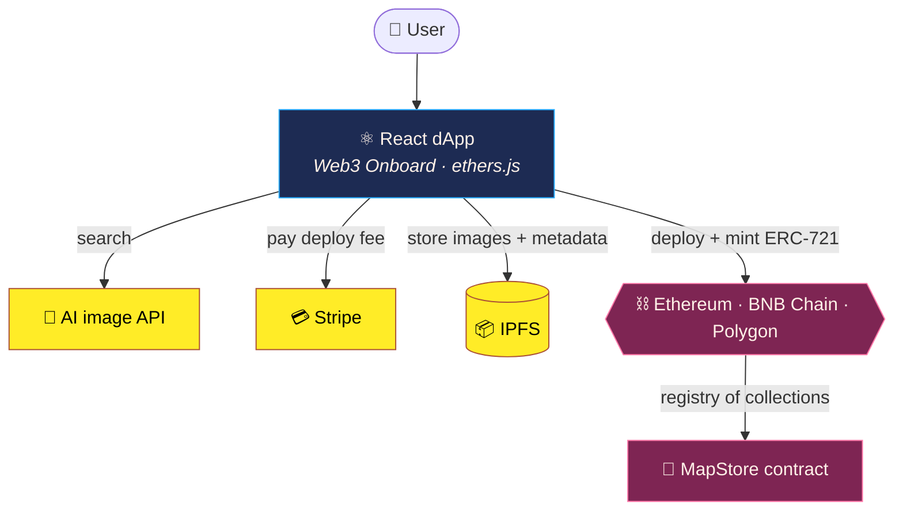

**20 years automating infrastructure · Master's in Blockchain · 8-bit games made at home with my daughters.**

**🇬🇧 English** · [🇪🇸 Español](README.es.md)

---

🤖 <b>Automation</b> · Infrastructure as code with <b>Terraform, Ansible and Packer</b> on AWS, Azure, Google Cloud and private cloud 
⛓️ <b>Blockchain</b> · <b>Master's in Blockchain</b>: smart contracts in <b>Solidity</b>, NFTs, IPFS and multichain dApps · 🏆 <a href="#blockchain">FrameBlock, best project of the Master's ↓</a> 
🕹️ <b>Games</b> · Small 8-bit games in pure HTML + JS, made with my daughters · <a href="https://bendi.dev/#arcade">Play →</a>

---

## 🕹️ Games

They all run in the browser, phones included. Nothing to install and no ads.

<!-- GAMES:START -->
<table>
<tr>
<td width="50%" valign="top">

**Dungeons & Deployments** 
Fantasy beat 'em up: a dev team fights its way through the data center catacombs, the Mainframe caves and the cloud. Solo or co-op.

<a href="https://bendi.dev/dungeons-and-deployments/"><b>▶ Play</b></a> · <a href="https://github.com/serbenda/dungeons-and-deployments">Code</a>

</td>
<td width="50%" valign="top">

**La Vuelta de Chapas** 
The classic bottle-cap game: a cycling tour and bottle-cap football, turn by turn, against friends or the machine.

<a href="https://bendi.dev/chapas/"><b>▶ Play</b></a> · <a href="https://github.com/serbenda/chapas">Code</a>

</td>
</tr>
<tr>
<td width="50%" valign="top">

**School Rush** 
Wake up, breakfast, wash, get dressed and dodge the traffic: get the kids to school before the 9:00 bell.

<a href="https://bendi.dev/school-rush/"><b>▶ Play</b></a> · <a href="https://github.com/serbenda/school-rush">Code</a>

</td>
<td width="50%" valign="top">

**Hemiciclo Fighters** 
90s arcade-style fighting game with fictional politicians, combos, specials and a final boss who never runs for election.

<a href="https://bendi.dev/hemiciclo-fighters/"><b>▶ Play</b></a> · <a href="https://github.com/serbenda/hemiciclo-fighters">Code</a>

</td>
</tr>
<tr>
<td width="50%" valign="top">

**La biblioteca mágica** 
Interactive stories to learn to read by playing, designed with dyslexia in mind: hints, four levels and reading aloud.

<a href="https://bendi.dev/story-reader/"><b>▶ Play</b></a> · <a href="https://github.com/serbenda/story-reader">Code</a>

</td>
<td width="50%" valign="top">

**Deploy Quest** 
8-bit adventure: a dev with a keyboard and an IaC Shield crawls the Systems Catacombs looking for the Grimoire of the Definition of Done.

<a href="https://github.com/serbenda/deploy-quest">Code</a>

</td>
</tr>
</table>
<!-- GAMES:END -->

<b>🧰 Other projects</b>

 

- **[Bankinter VISA → CSV](https://github.com/serbenda/bankinter-visa-pdf-to-csv)**: Turns Bankinter VISA PDF statements into a clean CSV.

---

## ⛓️ Blockchain

I hold a **Master's in Blockchain** from Universidad Europea (2022–2023). That's where I moved from running infrastructure to building on decentralized infrastructure: smart contracts, tokens, decentralised storage and dApps that work across several chains.

  
  
  
  
  
  
  
  

### 🏆 FrameBlock · Winner, best project of the Master's

  

> **February 2023.** After 14 intense weeks, five final projects were defended before a jury of industry experts, with people from **Telefónica, Polygon and Bit2Me** and a CTO who was an alumnus of the first edition. After a tough deliberation, they picked **FrameBlock** as the winner. [See the announcement on LinkedIn →](https://www.linkedin.com/feed/update/urn:li:share:7033036387415113728/)

**[FrameBlock](https://github.com/serbenda/frameblock)** is a framework to plug any application into **any blockchain**, whatever the vendor or technology, so the app doesn't have to deal with the complexity underneath. I built it together with [Roberto González Rey](https://www.linkedin.com/in/roberto-gonz%C3%A1lez-rey-018335118/) as our final project.

**The problem it tackles:** blockchain is still hard to use and hard to trust for most people and companies. You have to pick a chain, learn its tools, manage wallets and pay in crypto. FrameBlock hides those choices behind one layer, so the same app can work on several chains and the user never has to know which one is underneath.

To prove it works we built a real use case, **Simple AI Collection**: a dApp where you search AI-generated images, pick your favorites, store them on **IPFS** and mint them as your own **NFT collection (ERC-721)** on Ethereum, BNB Smart Chain or Polygon, paying the deployment fee by card.

| | |
|---|---|
| **Smart contracts** | ERC-721 collection with OpenZeppelin (`ERC721Enumerable`, `Ownable`) and an on-chain registry of every user's collections |
| **Frontend** | React dApp with Web3 Onboard: MetaMask, Ledger, Trezor, WalletConnect and more |
| **Storage** | IPFS node for the images and their metadata |
| **Networks** | Ethereum, BNB Smart Chain and Polygon from the same app |
| **Payments** | Stripe checkout for the deployment fee |

**What makes it different:**
- 🧩 **Vendor-agnostic**: one integration, several chains (Ethereum, BNB Smart Chain, Polygon), and room for more.
- 🙋 **Usable by non-crypto people**: sign in with the wallet you already have, or pay the deployment by card.
- 🔐 **Trust built in**: audited OpenZeppelin building blocks, an on-chain registry of who owns what, and files on IPFS that nobody can quietly change.
- 🚀 **A working product, not slides**: a live MVP with a real use case, shown end to end in the demo.

  <a href="https://github.com/serbenda/frameblock"><b>📂 Code</b></a> ·
  <a href="https://github.com/serbenda/frameblock/blob/main/doc/FRAMEBLOCK.mp4"><b>🎬 Demo video</b></a> ·
  <a href="https://github.com/serbenda/frameblock/blob/main/doc/frameblock_technical_v.2.0.pptx"><b>🛠️ Technical deck</b></a> ·
  <a href="https://github.com/serbenda/frameblock/blob/main/doc/frameblock_bussiness_v.3.0.pptx"><b>💼 Business deck</b></a>

---

## 👾 About me

I'm **Sergio Bendaña**, *Bendi*. I started in 2005 doing support and have since cleared most levels of infrastructure: 24x7 production UNIX, **12,000-server** farms, VMware-to-OpenStack migrations, Big Data with Cloudera and Hortonworks and, today, **infrastructure as code** with Terraform Enterprise, Ansible and Packer on AWS, Azure, Google Cloud and private cloud. And because I like knowing how the next layer works, I did a **Master's in Blockchain** and built [FrameBlock](#blockchain), which won best project of the Master's.

Off the clock: small games with my daughters, a homelab that keeps growing and anything that can be automated.

    
  

  
  
  
  
  

My full career and achievements, on <a href="https://bendi.dev/#sobre-mi">my website</a>.

---

## ⚡ Recent activity

<!-- ACTIVITY:START -->
- **[dungeons-and-deployments](https://github.com/serbenda/dungeons-and-deployments)** · `JavaScript` · ⭐ 1 · [▶ demo](https://serbenda.github.io/dungeons-and-deployments/) — Beat 'em up de fantasía en pixel art: cuatro héroes del equipo de desarrollo, solos o en cooperativo, cruzan las catacumbas del CPD, las cuevas del Mainframe y la nube. Sin dependencias, funciona en el navegador y en el móvil. (updated today)
- **[story-reader](https://github.com/serbenda/story-reader)** · `JavaScript` — Cuentos interactivos para leer en voz alta, pensados para la dislexia: pistas al azar, 4 niveles y reconocimiento de voz. (updated today)
- **[chapas](https://github.com/serbenda/chapas)** · `JavaScript` · ⭐ 1 — Juego de chapas de los 80: la vuelta ciclista por turnos, para jugar en el móvil o la tablet. Hecho para jugar con mis hijas. (updated today)
- **[hemiciclo-fighters](https://github.com/serbenda/hemiciclo-fighters)** · `HTML` — Juego de lucha 2D estilo recreativa de los 90 con políticos ficticios. HTML + JS, sin dependencias. (updated today)
- **[school-rush](https://github.com/serbenda/school-rush)** · `JavaScript` · ⭐ 1 — Despierta, desayuna, asea, viste y esquiva el tráfico: ¡lleva a los peques al cole antes de la campana! 🏫⏰ (updated today)
<!-- ACTIVITY:END -->

  

🤖 Refreshed every morning by a GitHub Action in this repo.

---

## 📈 Visits

  

GitHub views and game visits, counted without cookies. The full table, per project and per day, on <a href="https://bendi.dev/#visitas">my website</a>.

---

**Let's talk.** If you fancy talking about automation, gadgets or games, find me on <a href="https://www.linkedin.com/in/serbenda/">LinkedIn</a>.

Enjoying the games? You can support them on <a href="https://github.com/sponsors/serbenda">GitHub Sponsors</a> ❤

