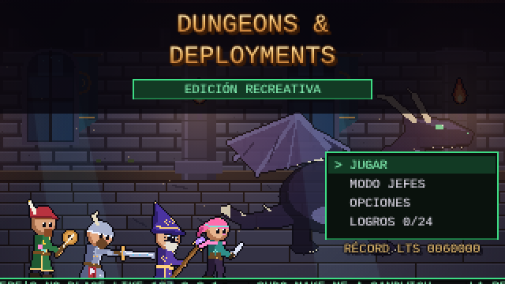
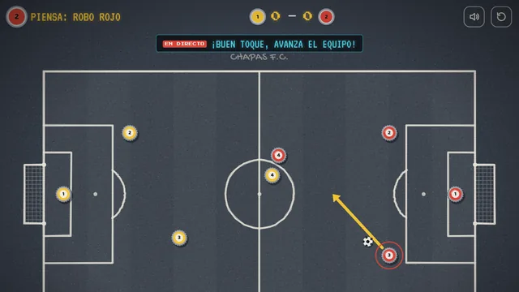
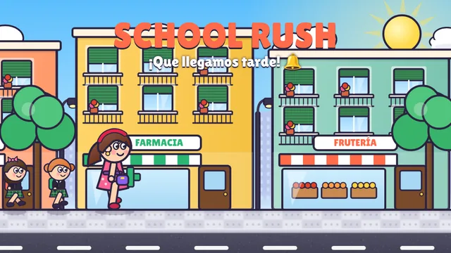
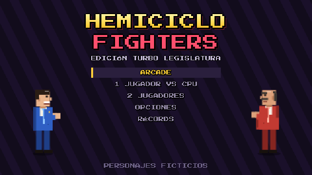
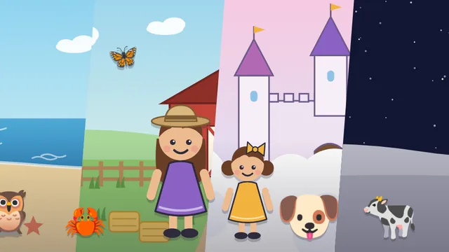
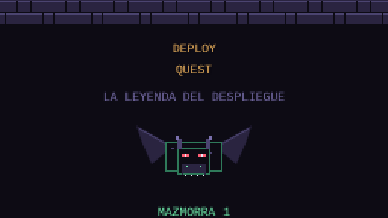
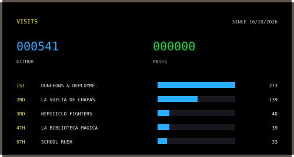

**20 years automating infrastructure. At home I make 8-bit games with my daughters.**

**🇬🇧 English** · [🇪🇸 Español](README.es.md)

---

## 🕹️ Games

They all run in the browser, phones included. Nothing to install and no ads.

<table>
<tr>
<td width="33%" valign="top">

**Dungeons & Deployments** 
Fantasy beat 'em up: a dev team fights its way through the data-centre catacombs, the Mainframe caves and the cloud. Solo or co-op.

<a href="https://serbenda.github.io/dungeons-and-deployments/"><b>▶ Play</b></a> · <a href="https://github.com/serbenda/dungeons-and-deployments">Code</a>

</td>
<td width="33%" valign="top">

**La Vuelta de Chapas** 
The classic bottle-cap game: a cycling tour and bottle-cap football, turn by turn, against friends or the machine.

<a href="https://serbenda.github.io/chapas/"><b>▶ Play</b></a> · <a href="https://github.com/serbenda/chapas">Code</a>

</td>
<td width="33%" valign="top">

**School Rush** 
Wake up, breakfast, wash, get dressed and dodge the traffic: get the kids to school before the 9:00 bell.

<a href="https://serbenda.github.io/school-rush/"><b>▶ Play</b></a> · <a href="https://github.com/serbenda/school-rush">Code</a>

</td>
</tr>
<tr>
<td width="33%" valign="top">

**Hemiciclo Fighters** 
90s arcade-style fighting game with fictional politicians, combos, specials and a final boss who never runs for election.

<a href="https://serbenda.github.io/hemiciclo-fighters/"><b>▶ Play</b></a> · <a href="https://github.com/serbenda/hemiciclo-fighters">Code</a>

</td>
<td width="33%" valign="top">

**La biblioteca mágica** 
Interactive stories to learn to read by playing, designed with dyslexia in mind: hints, four levels and reading aloud.

<a href="https://serbenda.github.io/story-reader/"><b>▶ Play</b></a> · <a href="https://github.com/serbenda/story-reader">Code</a>

</td>
<td width="33%" valign="top">

**Deploy Quest** 
8-bit adventure: a dev with a keyboard and an IaC Shield crawls the Systems Catacombs looking for the Grimoire of the Definition of Done.

<a href="https://github.com/serbenda/deploy-quest">Code</a>

</td>
</tr>
</table>

<b>🧰 Other projects</b>

 

- **[Bankinter VISA → CSV](https://github.com/serbenda/bankinter-visa-pdf-to-csv)**: Turns Bankinter VISA PDF statements into a clean CSV.
- **[FrameBlock](https://github.com/serbenda/frameblock)**: Framework for secure Web3 apps. Final project of my Master's in Blockchain.

---

## 👾 About me

I'm **Sergio Bendaña**, *Bendi*. I started in 2005 doing support and have since cleared most levels of infrastructure: 24x7 production UNIX, **12,000-server** farms, VMware-to-OpenStack migrations, Big Data with Cloudera and Hortonworks and, today, **infrastructure as code** with Terraform Enterprise, Ansible and Packer on AWS, Azure and private cloud. I also hold a **Master's in Blockchain**.

Off the clock: small games with my daughters, a homelab that keeps growing and anything that can be automated.

    
  

  
  
  
  
  

My full career and achievements, on <a href="https://serbenda.github.io/serbenda/#player1">my website</a>.

---

## ⚡ Recent activity

<table>
<tr>
<td width="55%" valign="top">

<!-- ACTIVITY:START -->
- **[dungeons-and-deployments](https://github.com/serbenda/dungeons-and-deployments)** · `JavaScript` · ⭐ 1 · [▶ demo](https://serbenda.github.io/dungeons-and-deployments/) — Beat 'em up de fantasía en pixel art: cuatro héroes del equipo de desarrollo, solos o en cooperativo, cruzan las catacumbas del CPD, las cuevas del Mainframe y la nube. Sin dependencias, funciona en el navegador y en el móvil. (updated today)
- **[chapas](https://github.com/serbenda/chapas)** · `JavaScript` · ⭐ 1 — Juego de chapas de los 80: la vuelta ciclista por turnos, para jugar en el móvil o la tablet. Hecho para jugar con mis hijas. (updated today)
- **[story-reader](https://github.com/serbenda/story-reader)** · `JavaScript` — Cuentos interactivos para leer en voz alta, pensados para la dislexia: pistas al azar, 4 niveles y reconocimiento de voz. (updated today)
- **[hemiciclo-fighters](https://github.com/serbenda/hemiciclo-fighters)** · `HTML` — Juego de lucha 2D estilo recreativa de los 90 con políticos ficticios. HTML + JS, sin dependencias. (updated today)
- **[school-rush](https://github.com/serbenda/school-rush)** · `JavaScript` · ⭐ 1 — Despierta, desayuna, asea, viste y esquiva el tráfico: ¡lleva a los peques al cole antes de la campana! 🏫⏰ (updated today)
<!-- ACTIVITY:END -->

🤖 Refreshed every morning by a GitHub Action in this repo.

</td>
<td width="45%" valign="top" align="center">

</td>
</tr>
</table>

---

## 📈 Visits

  

GitHub views and game visits, counted without cookies. The full table, per project and per day, on <a href="https://serbenda.github.io/serbenda/#records">my website</a>.

---

**Let's talk.** If you fancy talking about automation, gadgets or games, find me on <a href="https://www.linkedin.com/in/sergio-santiago-benda%C3%B1a-quesada/">LinkedIn</a>.

