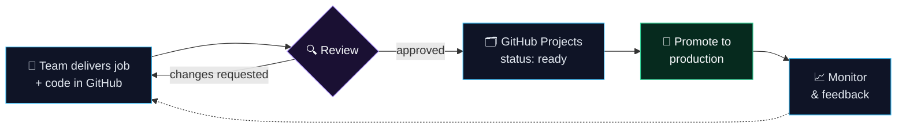

**I turn manual operations into reviewed, reliable automation, and I'm the last check before it hits production.**

**🇬🇧 English** · [🇪🇸 Español](README.es.md)

---

## 🧭 About me

I'm **Sergio Santiago Bendaña Quesada**, an engineer with **15+ years** across infrastructure automation, systems engineering and software development.

My day-to-day sits right between *"it works on my machine"* and *"it runs every night in production"*:

- ⚙️ **Rundeck automation**: I review the jobs technical teams deliver (Shell Script and Python plugins) together with the code behind them in GitHub.
- 🛡️ **Release gatekeeping**: nothing reaches production until it is correct, safe, idempotent and easy to roll back.
- 🗂️ **GitHub as the source of truth**: every request is tracked in GitHub Projects from delivery to production, and the boring parts run on GitHub Actions.

Before that I built infrastructure as code with Terraform and Ansible, migrated VMware estates to OpenStack, ran Big Data platforms on Cloudera and shipped full-stack apps with Node.js and React. I also hold a **Master's in Blockchain**.

---

## 🔁 How I ship automation

<b>📋 What I check before anything goes to production</b>

 

| Area | What I look for |
|---|---|
| **Correctness** | Does the job do exactly what the request says, with sensible defaults and validated options? |
| **Safety** | No secrets in plain text, least privilege, no destructive command without a guard. |
| **Idempotency** | Running it twice must not break anything. |
| **Failure handling** | Timeouts, retries, clear exit codes and an error message a human can act on. |
| **Rollback** | If it goes wrong at 3 a.m., how do we undo it? |
| **Code quality** | Readable Shell and Python, `set -euo pipefail`, linting, no copy-paste drift between environments. |
| **Traceability** | Linked to its card in GitHub Projects, versioned, and reviewable later. |

---

## 🛠️ Stack

    
    
  

  
  
  
  
  

---

## 🚀 Featured projects

<table>
<tr>
<td width="33%" valign="top">

### 🏃 [School Rush](https://github.com/serbenda/school-rush)
A cartoon race to get the kids to school before the 9:00 bell. Built to play with my daughters.

`HTML5 Canvas` `Vanilla JS` `0 deps` `GitHub Pages`

**[▶ Play it](https://serbenda.github.io/school-rush/)**

</td>
<td width="33%" valign="top">

### 🛡️ [FrameBlock](https://github.com/serbenda/frameblock)
Framework for building secure, scalable Web3 applications. Final project of my Master's in Blockchain.

`JavaScript` `Blockchain` `Web3`

</td>
<td width="33%" valign="top">

### 🏦 [Bankinter VISA → CSV](https://github.com/serbenda/bankinter-visa-pdf-to-csv)
Extracts transactions from Bankinter VISA PDF statements into clean CSV, ready for Excel or Power BI.

`Python` `PDF parsing` `CLI`

</td>
</tr>
</table>

---

## ⚡ Latest activity

<table>
<tr>
<td width="55%" valign="top">

<!-- ACTIVITY:START -->
- **[hemiciclo-fighters](https://github.com/serbenda/hemiciclo-fighters)** · `HTML` — Juego de lucha 2D estilo recreativa de los 90 con políticos ficticios. HTML + JS, sin dependencias. (updated today)
- **[school-rush](https://github.com/serbenda/school-rush)** · `HTML` — Despierta, desayuna, asea, viste y esquiva el tráfico: ¡lleva a los peques al cole antes de la campana! 🏫⏰ (updated today)
- **[chapas](https://github.com/serbenda/chapas)** · `JavaScript` · ⭐ 1 — Juego de chapas de los 80: la vuelta ciclista por turnos, para jugar en el móvil o la tablet. Hecho para jugar con mis hijas. (updated today)
- **[skills-introduction-to-github](https://github.com/serbenda/skills-introduction-to-github)** — My clone repository (updated 10 months ago)
- **[testgit](https://github.com/serbenda/testgit)** — No description yet. (updated 1 year ago)
<!-- ACTIVITY:END -->

🤖 Refreshed every day by a GitHub Action in this repo, because I automate everything.

</td>
<td width="45%" valign="top" align="center">

</td>
</tr>
</table>

---

## 🏆 Highlights

- 🛡️ Act as the **review and promotion gate for Rundeck automation**, with GitHub Projects as the single source of truth from delivery to production.
- ⏱️ Automated infrastructure provisioning with **Terraform Enterprise**, cutting deployment times significantly.
- ☁️ Migrated **VMware workloads to OpenStack**, improving resource usage and reducing costs.
- 🔐 Designed secure **CI/CD pipelines** that made teams faster without cutting corners.
- 🧰 Built **Python** and **Shell** tooling that removed hours of repetitive manual work.
- 📊 Delivered **Big Data** platforms on Cloudera for real-time analytics.

---

**Currently:** making automation reviews faster and more consistent · building small games with my kids · tinkering with a homelab

Open to talking about automation, platform engineering and safe releases. Find me on <a href="https://www.linkedin.com/in/sergio-santiago-benda%C3%B1a-quesada/">LinkedIn</a>.

